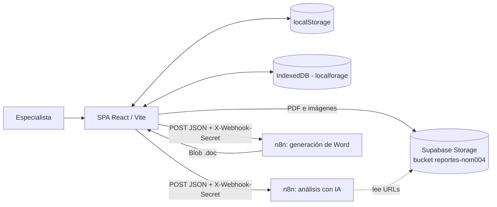

# Especificación de Requisitos de Software (SRS)
## ASCI NORMA 004 — Plataforma web de apoyo al cumplimiento de la NOM-004-STPS-1999

| Campo | Valor |
|---|---|
| Estándar | ISO/IEC/IEEE 29148 (Anexo B) |
| Proyecto | `ASCI-NOM-004` (paquete `asci-nom-004`, v0.0.0) |
| Versión del documento | 1.0 (borrador) |
| Fecha | 2026-10-19 |
| Método de elaboración | Ingeniería inversa del código fuente en `src/` y archivos de configuración |
| Estado | Pendiente de validación por las partes interesadas |

> [!IMPORTANT]
> No existía un ERS previo. Este documento describe el comportamiento **observado en el código actual**. La columna "Estado frente al sistema previo" y la Matriz Delta (Sección 6) se infieren de la estructura del código y del historial de commits (`Fase Inicial`, `Bug arreglado`, `Faltan ajustes`, `Proyecto Base web`, `pagina nom 004`). El código de la versión previa no está en el repositorio. Todo lo marcado **[A VALIDAR]** debe confirmarse con el equipo.

---

## 1. INTRODUCCIÓN

### 1.1 Propósito
Definir de forma completa, verificable y trazable los requisitos de la plataforma **ASCI NORMA 004**. Sirve de línea base para mantenimiento, pruebas de aceptación y futuras evoluciones. Se dirige a:
- Consultores y especialistas de seguridad (usuarios finales).
- Equipo de desarrollo y mantenimiento.
- Responsables de los flujos de automatización (n8n) y de la nube (Supabase).
- Líderes de proyecto y auditores.

### 1.2 Alcance del Sistema
**Objetivo de la plataforma.** Aplicación web de una sola página (SPA) que guía al especialista en la elaboración del estudio de riesgos de maquinaria y equipo de la **NOM-004-STPS-1999** ("Sistemas de protección y dispositivos de seguridad en la maquinaria y equipo que se utilice en los centros de trabajo"). Permite:
1. Capturar los datos generales del centro de trabajo (incisos a–i de la carátula del estudio).
2. Registrar cada máquina o equipo: identificación, condiciones de operación, manual PDF y evidencia fotográfica.
3. Obtener, mediante un flujo de IA orquestado en n8n, la descripción técnica, la tabla de riesgos potenciales y la matriz de valoración del riesgo.
4. Gestionar un borrador local de equipos.
5. Generar el informe final en formato Word (`.doc`).

**Alcance del rework frente a la versión base** (inferido del código; ver Sección 6):
- Persistencia de borradores en IndexedDB (`localforage`) en lugar de depender solo del estado en memoria.
- Almacenamiento de manuales e imágenes en Supabase Storage. A n8n se envían URLs, no archivos binarios.
- Compresión de imágenes en el cliente antes de subirlas.
- Identificación anónima por dispositivo (`device_id`) sin registro de usuarios.
- Autenticación de los webhooks con el encabezado `X-Webhook-Secret`.
- Edición de equipos guardados desde "Mis Equipos".
- Conversión de imágenes a Base64 en el navegador antes de generar el Word.
- Navegación responsiva con menú móvil.

**Fuera de alcance:** autenticación y cuentas de usuario, backend propio, base de datos relacional propia, firma electrónica, sincronización entre dispositivos, motor de cálculo de riesgo local (el cálculo lo hace el flujo n8n/IA) y los demás estudios del Programa de Seguridad.

### 1.3 Definiciones, Acrónimos y Abreviaturas

| Término | Definición |
|---|---|
| ASCI / AS Consultoría Integral | Firma consultora cuyos datos fijos aparecen como "Estudios elaborado por" |
| NOM-004-STPS-1999 | Norma Oficial Mexicana sobre protección y dispositivos de seguridad en maquinaria y equipo |
| STPS | Secretaría del Trabajo y Previsión Social |
| SRS / ERS | Software Requirements Specification / Especificación de Requisitos de Software |
| SPA | Single Page Application |
| n8n | Plataforma de automatización de flujos (webhooks) usada como backend de IA y de generación documental |
| Supabase | Backend como servicio; aquí se usa solo Storage |
| IndexedDB / localforage | Almacenamiento local del navegador y su librería de acceso |
| `device_id` | UUID generado en el navegador para identificar el dispositivo de forma anónima |
| RFC | Registro Federal de Contribuyentes |
| Matriz de valoración | Tabla Riesgo / Tipo de daño / Gravedad / Probabilidad / Valor / Nivel |
| Borrador | Equipo guardado localmente, aún no incluido en un informe |
| RF / RNF | Requisito Funcional / No Funcional |
| CORS | Cross-Origin Resource Sharing |

### 1.4 Referencias
1. ISO/IEC/IEEE 29148:2018 — *Systems and software engineering — Life cycle processes — Requirements engineering*.
2. **NOM-004-STPS-1999**, *Sistemas de protección y dispositivos de seguridad en la maquinaria y equipo que se utilice en los centros de trabajo*, DOF, STPS, México.
3. Código fuente del repositorio `ASCI-NOM-004` (`src/`, `package.json`, `vite.config.js`, `tailwind.config.js`, `index.html`).
4. Documentación de React 19, React Router 7, Vite, Tailwind CSS 4, `@supabase/supabase-js` y `localforage`.
5. Documentación de webhooks de n8n.

### 1.5 Descripción General del Documento
- La **Sección 2** describe el producto, los usuarios, el entorno y las restricciones.
- La **Sección 3** especifica las interfaces externas.
- La **Sección 4** contiene las fichas de requisitos funcionales (RF-01 a RF-16).
- La **Sección 5** recoge los requisitos no funcionales.
- La **Sección 6** presenta la matriz delta AS-IS vs TO-BE.

Convenciones: prioridad **Alta / Media / Baja**. Estado frente al sistema previo: **Nuevo / Modificado / Conservado**.

---

## 2. DESCRIPCIÓN GENERAL

### 2.1 Perspectiva del Producto
ASCI NORMA 004 es un cliente web autónomo. No tiene backend propio y se apoya en servicios externos:

**Contexto de la reingeniería.** El sistema sustituye una solución preliminar de la que no existe documentación formal. Según el historial de commits, esa solución tenía una fase inicial con instrucciones, landing y un primer formulario, y presentaba fallas corregidas después (`Bug arreglado`, `Faltan ajustes`). El rework consolida el flujo de extremo a extremo: datos de empresa → análisis por equipo → borrador → informe Word.

Flujo de usuario:
`Inicio (/)` → `Sobre la NOM-004` → `Datos empresariales (/formulario)` → `Análisis de Riesgo (/analisis-datos)` → `Mis Equipos (/mis-equipos)` → descarga del Word.

### 2.2 Funciones Principales del Producto
1. Información institucional y normativa (Landing, Sobre la NOM-004).
2. Captura y validación de los datos del centro de trabajo, con logotipo opcional.
3. Captura técnica de equipos: identificación, operación, descripción, manual PDF y fotos.
4. Análisis asistido por IA: descripción técnica, riesgos presentes/ausentes y matriz de valoración.
5. Guardado automático de borradores locales y gestión de equipos (ver, editar, eliminar).
6. Generación y descarga del informe Word consolidado.
7. Subida de archivos a la nube e identificación anónima por dispositivo.

### 2.3 Clases y Características de Usuarios

| Rol | Descripción | Permisos |
|---|---|---|
| **Especialista / Consultor SST** (único rol operativo) | Ingeniero o consultor que elabora el estudio. Se espera conocimiento básico de la NOM-004. | Acceso total a todas las vistas. Captura, edita, elimina y genera informes de **su propio dispositivo**. |
| Visitante informativo | Persona que solo consulta Landing y "Sobre la NOM-004". | Mismas rutas públicas. Técnicamente no hay distinción. |
| Administrador del flujo n8n / Supabase (externo) | Mantiene los webhooks, el bucket y los secretos. | Sin interfaz en la aplicación. |

> No existen cuentas, login ni control de acceso por rol en el código. La separación de datos depende solo del `device_id` y del almacenamiento local del navegador.

### 2.4 Entorno Operativo y Tecnologías Utilizadas

| Capa | Tecnología (según `package.json`) |
|---|---|
| UI | React ^19.2, React DOM, **React Compiler** (`babel-plugin-react-compiler`) |
| Enrutamiento | `react-router-dom` ^7 (`BrowserRouter`) |
| Estilos | Tailwind CSS ^4 (`@tailwindcss/postcss`), tipografías Barlow e Inter (Google Fonts) |
| Build | Vite ^8, `@vitejs/plugin-react`, `@rolldown/plugin-babel` |
| Persistencia local | `localforage` (IndexedDB, DB `NOM004_App`, store `equipos_borradores`), `localStorage` |
| Nube | `@supabase/supabase-js` ^2 (Storage, bucket `reportes-nom004`) |
| Automatización / IA | Webhooks n8n (análisis y generación de documento) |
| Calidad | ESLint ^10 (react-hooks, react-refresh) |

Entorno de ejecución: navegador moderno con soporte de ES Modules, IndexedDB, `FileReader`, `canvas`, `crypto.randomUUID` y `fetch`. Requiere un contexto seguro (HTTPS o localhost) para `crypto.randomUUID`. Se ejecuta con `npm run dev` y `npm run build`, y se publica como sitio estático (`dist/`).

### 2.5 Restricciones de Diseño e Implementación
- **R-01** El sistema es 100 % cliente. No hay servidor propio, así que la lógica de IA y de generación documental reside fuera del repositorio (n8n).
- **R-02** Variables de entorno obligatorias (`.env`, excluido de Git): `VITE_SUPABASE_URL`, `VITE_SUPABASE_ANON_KEY`, `VITE_N8N_ANALYSIS_URL`, `VITE_N8N_GENERATE_DOC_URL`, `VITE_N8N_WEBHOOK_SECRET`.
- **R-03** Toda variable `VITE_*` queda expuesta en el bundle del cliente.
- **R-04** El campo "Estudios elaborado por" es una constante del código (`DATOS_CONSULTORIA`) y no es editable.
- **R-05** Límites de negocio: logotipo ≤ 2 MB, máximo 3 imágenes por equipo, manual solo PDF, horas por turno ≤ 24.
- **R-06** El contrato JSON con n8n (campos de entrada y salida) es una dependencia rígida (ver 3.2).
- **R-07** Cumplimiento de la estructura de la NOM-004: 8 tipos de riesgo agrupados en los incisos a, b y c.
- **R-08** La interfaz y los textos están en español (México).

### 2.6 Supuestos y Dependencias
- **S-01** Los webhooks de n8n están disponibles, aceptan CORS desde el dominio de la app y validan `X-Webhook-Secret`.
- **S-02** El bucket `reportes-nom004` existe, es de lectura pública y permite subidas con la clave anónima.
- **S-03** n8n devuelve JSON con `descripcion`, `riesgos` y `matriz`, y un Blob Word en la generación.
- **S-04** Un mismo especialista usa siempre el mismo navegador y dispositivo. Si limpia los datos del navegador, pierde el borrador y el `device_id`.
- **S-05** Los datos de la empresa se capturan antes de generar el informe.
- **D-01** Disponibilidad de Internet para el análisis con IA, la subida de archivos y el Word.
- **D-02** Servicios de terceros: Supabase, n8n y Google Fonts.

---

## 3. REQUISITOS DE INTERFACES EXTERNAS

### 3.1 Interfaces de Usuario

| Ruta | Componente | Descripción |
|---|---|---|
| `/` | `Landing.jsx` | Portada con imagen hero y llamadas a la acción hacia "Sobre la NOM-004" y el formulario |
| `/sobre-nom004` | `About004.jsx` | Contenido informativo: objetivo, jerarquía y responsabilidades de la norma (imágenes `bg-*`) |
| `/formulario` | `Formulario.jsx` | "Datos del Centro de Trabajo": logotipo y campos a–i |
| `/analisis-datos` | `Analisisdatos.jsx` | "Análisis de Riesgo de Maquinaria": 5 secciones |
| `/mis-equipos` | `MisEquipos.jsx` | Listado de borradores y botón "Generar Reporte Word" |
| Global | `Navbar.jsx`, `Footer.jsx` | Barra superior fija con menú hamburguesa bajo `lg`, y pie de página |

**Formulario de datos de empresa (`/formulario`)**

| Inciso | Campo | Tipo | Obligatorio |
|---|---|---|---|
| — | Logotipo | Archivo PNG/JPG/WebP ≤ 2 MB | No |
| a | `company_name` Razón social | Texto | Sí |
| b | `company_address` Domicilio | Área de texto | Sí |
| c | `company_rfc` RFC | Texto (se muestra en mayúsculas) | Sí |
| d | `company_activity` Actividad | Texto | Sí |
| e | `total_workers` Número de trabajadores | Número | Sí |
| f | `work_schedule` Turnos y horarios | Texto | Sí |
| g | `elaborated_by` Elaborado por | Texto de solo lectura | Fijo |
| h | `specialist_name` Especialista | Texto | Sí |
| i | `stps_register` Registro STPS | Texto | Sí |

**Pantalla de análisis (`/analisis-datos`).** Secciones:
1. Identificación del equipo: `equipo*`, `identificacion`, `departamento`.
2. Condiciones de operación: `operadores`, días (Lu–Sa), `horas` (máx. 24), turnos 1/2/3.
3. Descripción y documentos: descripción técnica, PDF, botón "Análisis con IA", fotos (máx. 3).
4. Tabla "Riesgo Potencial por Tipo" con 8 filas (a1–c2) y casillas Presente/Ausente.
5. Matriz de valoración con código de color y diagrama de referencia (`diagrama.png`).

Acciones: "Atrás (Datos Empresa)", "Limpiar / Capturar Otro" y "Ver Mis Equipos".

**Catálogo de riesgos (`RIESGOS_BASE`)**

| Grupo | Código | Riesgo |
|---|---|---|
| a | a1, a2, a3 | Partes en movimiento; generación de calor; electricidad estática |
| b | b1, b2, b3 | Superficies cortantes; proyección de materia prima/subproducto/producto; calentamiento de materia prima/subproducto/producto |
| c | c1, c2 | Manejo de herramientas; condiciones de operación |

**Retroalimentación al usuario:** toasts (éxito/error, 4 s), overlays de carga con spinner ("Procesando con IA…", "Generando Documento Word…"), mensajes de error en rojo por campo y diálogo `confirm` antes de eliminar.

### 3.2 Interfaces de Software

| ID | Sistema | Protocolo | Detalle |
|---|---|---|---|
| IS-01 | **n8n — Análisis IA** (`VITE_N8N_ANALYSIS_URL`) | HTTPS `POST`, JSON, encabezado `X-Webhook-Secret` | **Entrada:** `device_id, equipo, identificacion, departamento, operadores, horas, dias[], turnos[], descripcion_manual, nombre_manual, manual_url, imagenes_urls[]`. **Salida:** `{ descripcion, riesgos: { <código>: { presente: bool, observacion } }, matriz: [ { riesgo, tipo_daño/tipo_danio, gravedad, probabilidad, valor, nivel } ] }`. Cualquier respuesta no 2xx lanza un error. |
| IS-02 | **n8n — Generación Word** (`VITE_N8N_GENERATE_DOC_URL`) | HTTPS `POST`, JSON, `X-Webhook-Secret` | **Entrada:** `device_id, empresa, direccion, rfc, actividad, total_trabajadores, horarios, especialista, registro_stps, logo (Base64), equipos[]` (cada equipo con `imagenes_base64[]`). **Salida:** Blob binario (.doc). |
| IS-03 | **Supabase Storage** (bucket `reportes-nom004`) | SDK `supabase-js` | Ruta de objeto `anonimo/{device_id}/{manuales\|imagenes}/{timestamp}_{rand}.{ext}`, con `upsert: true`. Devuelve una URL pública (`getPublicUrl`). |
| IS-04 | **IndexedDB** vía `localforage` | API local | DB `NOM004_App` / store `equipos_borradores`. Claves: `eq_{timestamp}_{rand}` por equipo y `borrador_actual` reservada. |
| IS-05 | **localStorage** | API local | Claves: `programa_seguridad_todos_datos`, `company_logo`, `company_name`, `company_address`, `app_device_id`. |
| IS-06 | **Google Fonts** | HTTPS | Barlow (700–900) e Inter (400–600) |

### 3.3 Interfaces de Comunicación
- HTTPS con `fetch` y JSON (`Content-Type: application/json`) hacia n8n. La respuesta de la generación se lee como `blob`.
- Descarga del archivo en el cliente con `URL.createObjectURL` y un `<a download>` llamado `Programa_Seguridad_Maquinaria_NOM004.doc`.
- Lectura de imágenes públicas de Supabase mediante `fetch(url)` para convertirlas a Base64. Requiere CORS permisivo en el bucket.
- La navegación interna usa la History API (`BrowserRouter`). Para recargas directas en rutas profundas, el hosting debe reescribir a `index.html`.

---

## 4. CARACTERÍSTICAS DEL SISTEMA (REQUISITOS FUNCIONALES)

> **Nota sobre "Estado frente al sistema previo":** inferido por ingeniería inversa. **[A VALIDAR]** con el equipo, porque el código base no está disponible para compararlo.

### RF-01 Navegación global y enrutamiento
- **Descripción:** El sistema ofrece barra de navegación persistente, pie de página y rutas SPA. Al cambiar de ruta se restablece el scroll al inicio.
- **Prioridad:** Alta
- **Entradas:** Ruta (`/`, `/sobre-nom004`, `/formulario`, `/analisis-datos`, `/mis-equipos`); clic en enlaces; estado del menú móvil.
- **Procesamiento:** `BrowserRouter` + `Routes`. `ScrollToTop` ejecuta `window.scrollTo(0,0)` en cada cambio de `pathname`. El menú móvil se abre y cierra con el botón hamburguesa y se cierra al elegir un enlace.
- **Salidas:** Vista correspondiente; enlaces de navegación a las 5 secciones.
- **Estado:** **Modificado** (se añadió la ruta `/mis-equipos` y el menú móvil).

### RF-02 Visualización informativa (Landing y Sobre la NOM-004)
- **Descripción:** Páginas de presentación del producto y de la norma.
- **Prioridad:** Media
- **Entradas:** Ninguna (solo navegación).
- **Procesamiento:** Renderizado estático. La Landing enlaza a `/sobre-nom004`.
- **Salidas:** Contenido informativo con recursos gráficos.
- **Estado:** **Conservado** **[A VALIDAR]** (el commit `pagina nom 004` indica una incorporación posterior al proyecto base).

### RF-03 Captura de datos del centro de trabajo
- **Descripción:** Formulario con los datos generales requeridos por la carátula del estudio (incisos a–i).
- **Prioridad:** Alta
- **Entradas:** `company_name, company_address, company_rfc, company_activity, total_workers, work_schedule, specialist_name, stps_register`; el campo `elaborated_by` es constante.
- **Procesamiento:**
  - Cada campo se actualiza en el estado y borra su error al editarse.
  - Al montar, se precargan los datos desde `localStorage`; `elaborated_by` se fuerza siempre a `DATOS_CONSULTORIA`.
- **Salidas:** Estado del formulario actualizado; formulario precargado con datos previos.
- **Estado:** **Modificado** (persistencia, campo fijo y ayudas contextuales con ejemplos) **[A VALIDAR]**.

### RF-04 Validación y guardado de datos de empresa
- **Descripción:** Valida los campos obligatorios, guarda localmente y continúa al análisis.
- **Prioridad:** Alta
- **Entradas:** Estado completo del formulario.
- **Procesamiento:**
  - Un campo es inválido si queda vacío tras `trim()`. Se validan 8 campos.
  - Si hay errores, se muestra un banner rojo y un mensaje por campo, y se hace scroll al inicio.
  - Si todo es válido, se guarda `programa_seguridad_todos_datos` (JSON) más `company_name` y `company_address`. Se muestra el aviso de éxito y a los 800 ms se navega a `/analisis-datos`.
  - *Limitación:* no se valida el formato del RFC, de la clave STPS ni valores numéricos negativos.
- **Salidas:** Datos persistidos; redirección a `/analisis-datos`; o mensajes de error.
- **Estado:** **Modificado**.

### RF-05 Gestión del logotipo de la empresa
- **Descripción:** Carga, previsualización y eliminación opcional del logotipo que se imprimirá en el Word.
- **Prioridad:** Media
- **Entradas:** Archivo PNG/JPEG/WebP.
- **Procesamiento:**
  - Si `file.size > 2 MB`, se rechaza con `alert`.
  - Si es válido, se convierte a Base64 (`FileReader.readAsDataURL`), se guarda en el estado y en `localStorage['company_logo']`.
  - "Eliminar logotipo" borra el estado y la clave de `localStorage`.
- **Salidas:** Vista previa con indicador "✓ Logotipo cargado"; Base64 disponible para el payload de RF-14.
- **Estado:** **Nuevo** **[A VALIDAR]**.

### RF-06 Captura de identificación y condiciones de operación del equipo
- **Descripción:** Registro de los datos básicos y operativos de cada máquina.
- **Prioridad:** Alta
- **Entradas:** `equipo` (marca/modelo, obligatorio para analizar), `identificacion` (tag), `departamento`, `operadores` (número), `dias` (Lu–Sa, selección múltiple), `horas` (número), `turnos` (1, 2, 3, selección múltiple).
- **Procesamiento:**
  - Los días y turnos funcionan como alternancia (agregar/quitar).
  - Si `horas > 24`, se muestra un toast de error y el valor se fija en 24.
  - El input `horas` tiene atributo `max="24"`.
  - *Limitación:* no se bloquean valores negativos ni se exige un mínimo de operadores.
- **Salidas:** Estado `equipoData` actualizado.
- **Estado:** **Modificado** (límite de 24 h y selección múltiple de días y turnos) **[A VALIDAR]**.

### RF-07 Carga de manual técnico (PDF)
- **Descripción:** Adjunta el manual o ficha técnica del equipo como insumo para la IA.
- **Prioridad:** Alta
- **Entradas:** Un archivo.
- **Procesamiento:**
  - Es válido si el MIME es `application/pdf` o el nombre termina en `.pdf` (sin distinguir mayúsculas).
  - Si no es PDF, se muestra un error, se limpia el input y se rechaza.
  - Si es válido, se guardan `archivo_adjunto` y `archivo_nombre`, y se vacía `manual_url` para forzar una nueva subida.
  - *Limitación:* no se valida el tamaño máximo del PDF.
- **Salidas:** Nombre del archivo en pantalla y toast de confirmación.
- **Estado:** **Modificado** (restricción exclusiva a PDF y subida a la nube) **[A VALIDAR]**.

### RF-08 Evidencia fotográfica con compresión
- **Descripción:** Carga hasta 3 fotografías por equipo, optimizadas en el cliente.
- **Prioridad:** Alta
- **Entradas:** Archivos JPG/JPEG/PNG (selección múltiple).
- **Procesamiento:**
  1. Espacio disponible = 3 − imágenes ya cargadas. Si es ≤ 0, se rechaza con un mensaje.
  2. Se filtran los formatos válidos (por MIME o extensión). Si se ignoraron archivos, se avisa.
  3. Si hay más archivos que espacio, se recortan al espacio disponible y se avisa.
  4. Cada imagen se comprime con `comprimirImagen`: ancho máximo 1280 px proporcional, canvas, JPEG de calidad 0.75, con nombre `.jpg`.
  5. Se genera una vista previa con `URL.createObjectURL`.
  6. Si una imagen falla, se informa el error y se continúa con las demás.
  - Se puede quitar cada imagen con el botón ✕. El input se deshabilita al llegar a 3.
- **Salidas:** Miniaturas, contador "n / 3 foto(s) optimizada(s)" y objetos `{id, name, file, preview, url}`.
- **Estado:** **Nuevo** (compresión y límite) **[A VALIDAR]**.

### RF-09 Subida de archivos a la nube (Supabase Storage)
- **Descripción:** Sube el manual y las imágenes al bucket y obtiene URLs públicas para el análisis.
- **Prioridad:** Alta
- **Entradas:** `File`, carpeta (`manuales` | `imagenes`), `device_id`.
- **Procesamiento:**
  - El nombre es `{Date.now()}_{4 caracteres aleatorios}.{ext}` y la ruta es `anonimo/{device_id}/{carpeta}/{nombre}`.
  - Se usa `upload(..., {upsert: true})`.
  - Si hay error, se lanza `Error("Error al subir archivo a la nube: …")`.
  - En caso de éxito se llama a `getPublicUrl`.
  - Se evita volver a subir si el manual o la imagen ya tienen URL.
  - Las imágenes se suben en paralelo (`Promise.all`).
- **Salidas:** URL pública por archivo.
- **Estado:** **Nuevo** **[A VALIDAR]**.

### RF-10 Identificación anónima de dispositivo
- **Descripción:** Asigna un identificador persistente por navegador para segmentar el almacenamiento y trazar las solicitudes.
- **Prioridad:** Media
- **Entradas:** `localStorage['app_device_id']`.
- **Procesamiento:** Si no existe, genera `crypto.randomUUID()` y lo guarda. Si existe, lo devuelve.
- **Salidas:** UUID usado en rutas de Storage y en los payloads de n8n.
- **Estado:** **Nuevo** **[A VALIDAR]**.

### RF-11 Análisis de riesgos con IA y autoguardado
- **Descripción:** Envía los datos del equipo a n8n y completa la descripción, los riesgos y la matriz. Guarda automáticamente el equipo como borrador.
- **Prioridad:** Alta
- **Entradas:** `equipoData`, imágenes cargadas, manual PDF opcional.
- **Procesamiento:**
  1. **Validación previa:** `equipo` no vacío. Si lo está, se muestra un error y se cancela.
  2. Se activa el overlay "Procesando con IA…".
  3. Se sube el manual si hay archivo nuevo sin URL, y las imágenes sin URL (RF-09).
  4. Se construye el payload (IS-01) y se llama a `analizarEquipoConIA`.
  5. Se procesa la respuesta:
     - `descripcion` reemplaza la descripción (o se conserva la manual si no llega).
     - Para cada código de `riesgos` conocido: `presente = (rIA.presente === true)`, `ausente = (rIA.presente === false)`, `observacion = rIA.observacion` (o "No aplica" si está ausente).
     - `matriz` reemplaza la matriz (o se conserva la anterior).
  6. Se asigna `id` (el existente o `eq_{ts}_{rand}`) y se guarda con `dbService.guardarEquipo`, incluyendo `device_id`, `fecha`, riesgos, matriz y URLs. El `File` adjunto no se guarda.
  7. Cualquier error se muestra en un toast. El overlay se cierra en `finally`.
- **Salidas:** Formulario y matriz actualizados; equipo guardado; toast "Análisis técnico completado y guardado en Mis Equipos".
- **Estado:** **Modificado** (autoguardado y uso de URLs en lugar de archivos binarios) **[A VALIDAR]**.

### RF-12 Registro manual de riesgos potenciales
- **Descripción:** Permite al especialista marcar o corregir manualmente los 8 riesgos de la NOM-004.
- **Prioridad:** Alta
- **Entradas:** Casillas Presente/Ausente y observación por cada código (a1…c2).
- **Procesamiento:**
  - *Presente y Ausente son mutuamente excluyentes:* al marcar uno, se desmarca el otro.
  - Al marcar *Ausente*, la observación se fija en "No aplica".
  - La observación es editable libremente.
- **Salidas:** `riesgosState` actualizado.
- **Estado:** **Conservado** **[A VALIDAR]** (la tabla es el núcleo funcional según la NOM).

### RF-13 Visualización de la matriz de valoración
- **Descripción:** Muestra la matriz Riesgo / Tipo de daño / Gravedad / Probabilidad / Valor / Nivel con semáforo.
- **Prioridad:** Alta
- **Entradas:** `matrizState` (de la IA o del equipo cargado).
- **Procesamiento:** El color del "Nivel" depende del `valor` numérico:

  | Valor | Estilo |
  |---|---|
  | ≥ 15 | Rojo |
  | 9 – 14 | Amarillo |
  | 4 – 8 | Verde |
  | < 4 o no numérico | Gris |

  Si la matriz está vacía, muestra 4 filas de relleno con "Sin riesgos presentes registrados". Soporta `tipo_daño` y `tipo_danio`. Junto a la tabla se muestra `diagrama.png`.
- **Salidas:** Tabla coloreada.
- **Estado:** **Modificado** **[A VALIDAR]**.

### RF-14 Gestión de borradores locales de equipos (Mis Equipos)
- **Descripción:** Lista los equipos guardados con su estado y permite verlos/editarlos o eliminarlos.
- **Prioridad:** Alta
- **Entradas:** Registros de IndexedDB; acciones "Ver / Editar", "Eliminar", "Agregar Equipo".
- **Procesamiento:**
  - **Listar:** `dbService.obtenerTodos()` excluye la clave `borrador_actual` y muestra nombre, departamento, tag y los indicadores "Analizado con IA" / "Pendiente de Análisis" (según exista `matriz`) y "PDF Adjunto" (si hay `manual_url`).
  - **Eliminar:** pide confirmación con `confirm`. Si se acepta, borra el registro y recarga la lista.
  - **Ver / Editar:** navega a `/analisis-datos` con `state.equipoEditar`. La pantalla precarga datos, riesgos, matriz y hasta 3 imágenes por URL.
  - **Vacío:** muestra el mensaje "No hay equipos guardados en el borrador".
  - El contador `({n})` se actualiza en el encabezado.
- **Salidas:** Lista actualizada, toasts y navegación.
- **Estado:** **Nuevo**.

### RF-15 Generación y descarga del informe Word
- **Descripción:** Consolida los datos de la empresa y de todos los equipos, solicita el documento a n8n y lo descarga.
- **Prioridad:** Alta
- **Entradas:** Todos los equipos de IndexedDB; `programa_seguridad_todos_datos` y `company_logo` de `localStorage`; `device_id`.
- **Procesamiento:**
  1. Si no hay equipos, muestra un error y termina. El botón solo aparece si hay equipos.
  2. Overlay "Generando Documento Word…".
  3. Para cada equipo, se toman `imagenes_urls` o `imagenes` y se convierte cada una a Base64 en el navegador con `urlToBase64Navegador`:
     - Si ya es `data:image`, se devuelve tal cual.
     - Se limpian espacios y saltos de línea de la URL.
     - Si falla la conversión, se devuelve la URL original.
  4. Se arma el payload (IS-02) con los datos de la empresa y `equipos[]` con `imagenes_base64`.
  5. Se llama a `generarDocumentoWord`. Si el estado HTTP no es OK, se lanza un error.
  6. Se descarga como `Programa_Seguridad_Maquinaria_NOM004.doc`.
  7. Los errores se muestran en un toast y el overlay se cierra en `finally`.
  - *Observación:* no se valida que existan los datos de empresa. Si faltan, se envían cadenas vacías.
- **Salidas:** Archivo `.doc` descargado y toast de éxito.
- **Estado:** **Modificado** (conversión de imágenes en el cliente y payload consolidado) **[A VALIDAR]**.

### RF-16 Edición, limpieza y reinicio del formulario de análisis
- **Descripción:** Permite capturar otro equipo o editar uno existente sin mezclar datos.
- **Prioridad:** Media
- **Entradas:** `location.state.equipoEditar`; botón "Limpiar / Capturar Otro".
- **Procesamiento:**
  - **Edición:** carga todos los campos del equipo, incluido su `id`. Si se vuelve a analizar, se **sobrescribe** el mismo registro (no se duplica).
  - **Limpieza:** restablece `equipoData` (con `id: null`), los 8 riesgos, la matriz y las imágenes, y muestra un toast de confirmación.
  - Las imágenes ya subidas conservan su `url` y no se vuelven a subir.
- **Salidas:** Formulario precargado o vacío.
- **Estado:** **Nuevo** (reutilización del `id` para evitar duplicados) **[A VALIDAR]**.

### Resumen de trazabilidad

| RF | Módulo / Archivo | Estado |
|---|---|---|
| RF-01 | `App.jsx`, `Navbar.jsx`, `Footer.jsx` | Modificado |
| RF-02 | `Landing.jsx`, `About004.jsx` | Conservado |
| RF-03, 04, 05 | `Formulario.jsx` | Modificado / Modificado / Nuevo |
| RF-06, 07, 08, 12, 13, 16 | `Analisisdatos.jsx` | Modificado / Modificado / Nuevo / Conservado / Modificado / Nuevo |
| RF-09 | `storageService.js`, `supabaseClient.js` | Nuevo |
| RF-10 | `deviceId.js` | Nuevo |
| RF-11 | `Analisisdatos.jsx`, `n8nService.js`, `dbService.js` | Modificado |
| RF-14, 15 | `MisEquipos.jsx`, `dbService.js`, `n8nService.js` | Nuevo / Modificado |

---

## 5. REQUISITOS NO FUNCIONALES

### 5.1 Rendimiento
- **RNF-01** Las imágenes se comprimen en el cliente (máx. 1280 px, JPEG 0.75) antes de subirse, para reducir el ancho de banda.
- **RNF-02** Las subidas de imágenes y las conversiones a Base64 se ejecutan en paralelo (`Promise.all`).
- **RNF-03** La interfaz debe mostrar un indicador de carga durante las operaciones con la red (IA y Word). No hay timeout configurado en `fetch` **[A VALIDAR si se requiere]**.
- **RNF-04** La lista de equipos se lee de IndexedDB en el cliente. Se espera una carga fluida con decenas de equipos.
- **RNF-05** El build de producción (Vite) genera recursos estáticos. Hay imágenes de fondo muy pesadas (2–3.5 MB cada una en `src/img/`) que impactan la carga inicial.

### 5.2 Seguridad y Protección de Datos
- **RNF-06** Las llamadas a n8n se autentican con `X-Webhook-Secret`. *Limitación:* el secreto es `VITE_*`, por lo que **es visible en el bundle** y solo funciona como control débil. Se recomienda un proxy o una validación por origen/rate limit.
- **RNF-07** `.env` está excluido del control de versiones.
- **RNF-08** No hay autenticación. Los datos se segmentan por `device_id` (UUID anónimo). Quien conozca ese UUID y la URL del bucket puede acceder a los archivos.
- **RNF-09** Los archivos se publican con URL **públicas**. Esto es necesario para que n8n los lea, pero expone manuales y fotos. Se recomienda evaluar URLs firmadas.
- **RNF-10** Los datos de empresa (razón social, RFC, domicilio) se almacenan sin cifrar en `localStorage`/IndexedDB, accesibles a cualquier script del mismo origen.
- **RNF-11** Se usa `upsert: true` en Storage. Un nombre con timestamp y valor aleatorio reduce las colisiones.
- **RNF-12** Las comunicaciones deben usar HTTPS exclusivamente.
- **RNF-13** Privacidad: el sistema trata datos empresariales y fotos de instalaciones. Se debe informar su uso y el almacenamiento en la nube conforme a la LFPDPPP **[A VALIDAR]**.

### 5.3 Usabilidad y Diseño Adaptativo
- **RNF-14** Diseño responsivo con Tailwind (cuadrículas `grid-cols-1` → `md:` → `lg:`). Menú hamburguesa bajo el breakpoint `lg`, y tablas con `overflow-x-auto`.
- **RNF-15** Marcación visual de obligatorios (asterisco rojo), errores en línea, ejemplos de llenado bajo cada campo y retroalimentación por toast y overlay.
- **RNF-16** Idioma y terminología consistentes con la NOM-004. Tipografías Barlow (títulos) e Inter (cuerpo), y paleta institucional `#002060`.
- **RNF-17** Confirmación previa a acciones destructivas (eliminar equipo).
- **RNF-18** Accesibilidad: hay `alt` en imágenes y `aria-label` en el menú. Faltan asociaciones `label`↔`input` (`htmlFor`/`id`) y las alertas no usan `role="alert"` **[mejora recomendada]**.
- **RNF-19** El campo `lang` de `index.html` es `en`, y el `title` es `asci-nom-004`. Debería ser `es` y un título descriptivo **[hallazgo]**.

### 5.4 Mantenibilidad
- **RNF-20** Arquitectura por capas simple: `pages/` (vistas), `components/` (UI compartida), `services/` (n8n, Supabase, IndexedDB), `utils/` (compresión, deviceId).
- **RNF-21** Las URLs y credenciales son configurables por variables de entorno. No están en el código.
- **RNF-22** Se usa ESLint con reglas de React Hooks. Está habilitado el React Compiler.
- **RNF-23** *Deuda técnica detectada:*
  - No hay pruebas automatizadas.
  - `Analisisdatos.jsx` (~770 líneas) concentra estado, reglas y UI.
  - Hay duplicación de componentes (toast y overlay).
  - El `README.md` es la plantilla de Vite y no documenta variables ni el contrato de n8n.
  - Hay dos copias de `favicon.svg`.
  - La carpeta `dist` está versionada (commit `Carpeta dist`).
  - Existe código no usado (`cargarBorradorLocal` y `guardarBorradorLocal`).
  - `alert` y `confirm` nativos conviven con toasts.
- **RNF-24** Los servicios capturan errores y los relanzan o los registran con `console.error`. Algunos (`dbService`) los silencian.

---

## 6. ANEXO: MATRIZ DELTA DE CAMBIOS (AS-IS vs TO-BE)

> [!WARNING]
> La columna **AS-IS** es una **inferencia** a partir del historial de commits y de patrones del código. No se pudo comparar contra el código previo. Debe validarse con el equipo responsable antes de usarse como evidencia formal.

| # | Área | AS-IS (versión previa, inferido) | TO-BE (rework actual) | RF |
|---|---|---|---|---|
| 1 | Arquitectura | Landing y un primer formulario; flujo parcial | SPA con 5 rutas y flujo completo: empresa → análisis → borradores → informe Word | RF-01 |
| 2 | Datos de empresa | Captura básica | Formulario con incisos a–i, validación de 8 campos obligatorios, ejemplos y campo fijo "Elaborado por" | RF-03/04 |
| 3 | Persistencia | Estado en memoria o ligero **[A VALIDAR]** | `localStorage` (empresa y logo) más IndexedDB (equipos) con IDs únicos | RF-04/14 |
| 4 | Identidad visual del informe | Sin logotipo **[A VALIDAR]** | Carga de logotipo ≤ 2 MB en Base64 para el Word | RF-05 |
| 5 | Archivos adjuntos | Envío directo o inexistente **[A VALIDAR]** | Subida a Supabase y envío de URLs a n8n | RF-09/11 |
| 6 | Imágenes | Sin control de tamaño ni cantidad | Máx. 3, JPG/PNG, compresión a 1280 px / 0.75 | RF-08 |
| 7 | Manual técnico | Formato libre **[A VALIDAR]** | Solo PDF con validación MIME/extensión | RF-07 |
| 8 | Análisis de riesgos | Captura manual **[A VALIDAR]** | Análisis con IA (n8n) que rellena descripción, riesgos y matriz. Se mantiene la edición manual | RF-11/12 |
| 9 | Matriz | Sin semáforo **[A VALIDAR]** | Matriz con color por valor (≥15 / ≥9 / ≥4) y diagrama de referencia | RF-13 |
| 10 | Gestión de equipos | Un solo equipo por sesión **[A VALIDAR]** | "Mis Equipos": listado, edición, eliminación, estado de análisis | RF-14/16 |
| 11 | Duplicados | Posible duplicación al reanalizar (commit `Bug arreglado`) | `guardarEquipo` reutiliza `equipo.id`. Si no existe, genera uno con timestamp y valor aleatorio | RF-11/16 |
| 12 | Validación de horas | Sin tope | Límite de 24 h con ajuste automático y aviso | RF-06 |
| 13 | Riesgos | Estados no excluyentes **[A VALIDAR]** | Presente/Ausente excluyentes y "No aplica" automático | RF-12 |
| 14 | Generación del documento | Sin automatización o parcial | Descarga del Word por n8n, con imágenes convertidas a Base64 en el cliente | RF-15 |
| 15 | Seguridad de integración | Sin control en webhooks **[A VALIDAR]** | Encabezado `X-Webhook-Secret` (limitado por exposición en cliente) | RNF-06 |
| 16 | Trazabilidad | Sin identificación | `device_id` anónimo en rutas de Storage y payloads | RF-10 |
| 17 | Usabilidad móvil | Navegación de escritorio **[A VALIDAR]** | Menú hamburguesa, cuadrículas responsivas, toasts y overlays | RNF-14/15 |

### Hallazgos y recomendaciones para el siguiente ciclo
1. Documentar el contrato JSON con n8n y las variables `.env` en el `README.md`.
2. Sustituir el secreto del webhook en el cliente por un proxy o validación del lado del servidor.
3. Evaluar URLs firmadas y políticas RLS en Supabase.
4. Añadir validación de formato (RFC, números no negativos, tamaño máximo del PDF).
5. Validar que existan los datos de empresa antes de generar el Word.
6. Corregir `lang="es"` y el `title`, y mejorar la accesibilidad (`htmlFor`, `role="alert"`).
7. Optimizar las imágenes de fondo (2–3.5 MB) y extraer los componentes compartidos (toast, overlay).
8. Añadir pruebas automatizadas y retirar `dist/` del control de versiones.
9. Evaluar un respaldo o exportación de los borradores, para evitar su pérdida al limpiar el navegador.

*Fin del documento.*

